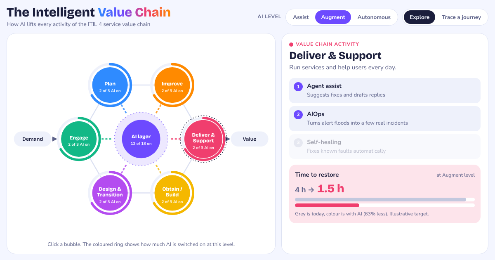

# The Intelligent Value Chain

**An interactive, one-screen map of how AI lifts every activity of the ITIL 4 service value chain.**

Live: https://kate1819.github.io/ai-value-chain/

## What you can do

- **Explore the chain.** Click any of the six activities (Plan, Improve, Engage, Design & Transition, Obtain/Build, Deliver & Support) to see three ways AI helps and one headline metric before and after AI. Click the AI layer in the middle to see the shared foundation every activity draws on.
- **Turn up the AI level.** Switch between Assist (AI suggests, people act), Augment (AI drafts, people approve) and Autonomous (AI acts inside guardrails). The rings fill, the connections grow stronger and the targets change.
- **Trace a journey.** Play one of three end-to-end journeys (fix a VPN outage, onboard a new hire, ship a new feature) and watch it move through the chain, with the time saved at each step and overall.

The numbers are illustrative targets to start a conversation, not benchmarks.

## Files

- `index.html`: the whole page, with inline CSS and JavaScript. It needs no build step.
- `preview.png`: the 1200 x 630 picture used on the portfolio homepage.

ITIL® is a registered trademark of AXELOS Limited.
